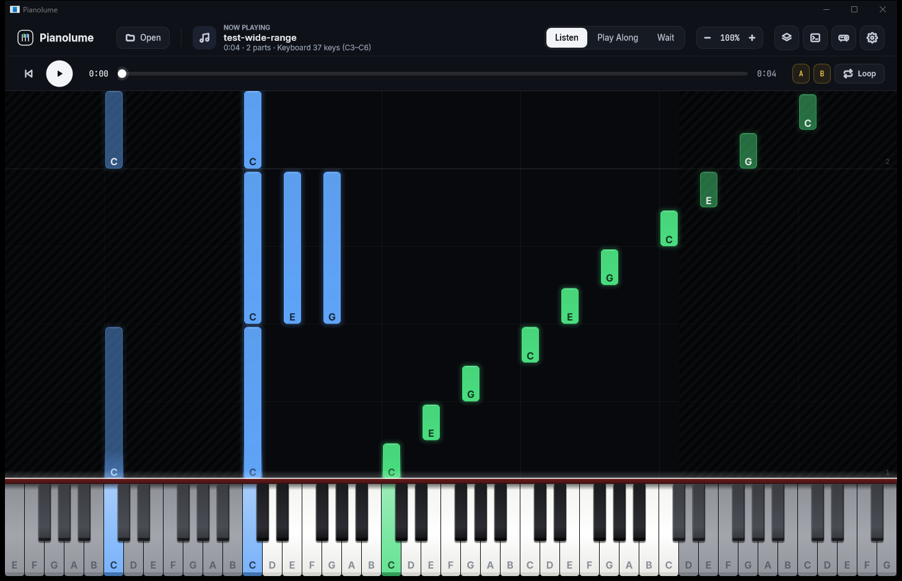
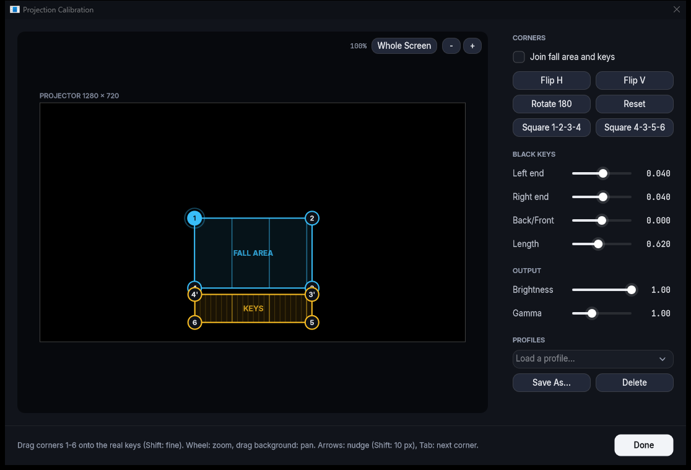

# Pianolume

[English](README.md) | **日本語**

Pianolume は、プロジェクタで本物の鍵盤に押し順を映すピアノ練習アプリです。
イメージは「Synthesia ＋ プロジェクションマッピング」です。鍵盤の奥から手前へバーが流れてきて、押すタイミングで鍵が光ります。MIDI で受け取った実際の演奏にも反応します。



> **状態:** 開発の初期段階（v0.1）です。Windows のみ対応しています。開発と動作確認には IK Multimedia iRig Keys 37 Pro を使っています。

## 主な機能

- **落下バー**: Synthesia 風の表示を OpenGL で描きます。小節線・拍線を表示でき、ノーツと鍵盤に音名を出すこともできます
- **本物の鍵盤への投影**: 落下エリアと鍵盤エリアを別の面として扱い、それぞれ実物の形に合わせて変形します
- **キャリブレーション**: 四隅をドラッグして実物に合わせます。拡大して細かく調整したり、ワンクリックで長方形にそろえたりできます。黒鍵は白鍵より高いので、ななめから投影すると位置がずれます。その補正もできます。結果はプロファイルとして保存できます
- **MIDI ファイル**: `.mid` を読み込み、パートごとに右手・左手・伴奏・ミュートを割り当てます。速度の変更やシークもできます
- **練習モード**: Listen（聴く）、Play Along（一緒に弾く）、Wait（正しい鍵を押すまで待つ）の3つと、A-B ループ
- **内蔵音源**: FluidSynth で `.sf2` / `.sf3` の SoundFont を鳴らします。WASAPI の共有 / 排他モードとリミッターに対応しています
- **キーボード対応**: 25〜88 鍵から選べて、最低音は自動で検出できます。キーボードのオクターブボタンに追随し、プログラムチェンジで音色を切り替えます
- **鍵数の違い**: 画面の鍵盤を手元のキーボードより広くできます。範囲外の音はグレーで表示し、自動で演奏します



## 必要なもの

- Windows 10 / 11
- MIDI キーボード（USB MIDI）
- プロジェクタ（なくても、モニタだけで使えます）
- 音を出すための SoundFont（`.sf2` / `.sf3`）。たとえば [GeneralUser GS](https://schristiancollins.com/generaluser.php)。SoundFont は同梱していません

## ビルド

次のものが必要です。

- Visual Studio 2022（「C++ によるデスクトップ開発」ワークロード）
- CMake 3.24 以上

```powershell
cmake -S . -B build -G "Visual Studio 17 2022" -A x64
cmake --build build --config Release
```

JUCE と FluidSynth は、初回の構成時に CMake が自動で取得します。
実行ファイルは `build/Pianolume_artefacts/Release/Pianolume.exe` にできます。必要な FluidSynth の DLL も同じフォルダに置かれます。

練習には Release ビルドを使ってください。Debug ビルドは描画がかなり重くなります。

## 使い方

1. MIDI キーボードをつないで Pianolume を起動します。
2. **Settings** を開きます。
   - **INPUT KEYBOARD**: MIDI デバイスと鍵数を選びます。**Detect** を押してから、一番左の鍵を押します。
   - **SOUND**: **Load...** で SoundFont を選びます。
3. **Open** を押して `.mid` を読み込みます。ウィンドウへのドラッグ＆ドロップでも読み込めます。**Parts** で、どのパートをどちらの手で弾くかを選びます。
4. **Space** で再生します。

### プロジェクタの設定

1. プロジェクタを2台目のディスプレイとしてつなぎ、**Settings > DISPLAY > Projector** で選びます。
2. **Calibrate...** を押し、四隅を実物の鍵盤に合わせてドラッグします。
   - **1-2-3-4**: 落下エリア（鍵盤の奥の面）
   - **4-3-5-6**: 鍵盤の上面
   - 2つの面の高さが違うときは、**Join fall area and keys** のチェックを外すと別々に調整できます。
3. 黒鍵がずれて見えるときは、**BLACK KEYS > Left end / Right end** で補正します。
4. **PROFILES > Save As...** で保存します。
5. 投影は、ヘッダーの **Projection** ボタンで表示 / 非表示を切り替えます。

## 操作

| キー | 動作 |
| --- | --- |
| Space | 再生 / 一時停止 |
| Home | 先頭へ戻る |
| ← / → | 5 秒移動 |
| A / B | ループの始点 / 終点 |
| L | ループの ON / OFF |
| Esc | 全画面の投影を閉じる |

### キャリブレーション画面

| 操作 | 動作 |
| --- | --- |
| 角をドラッグ | 角を動かす（Shift を押すと細かく動く） |
| マウスホイール、`+` / `-` | 拡大 / 縮小 |
| 背景をドラッグ（右・中ボタンのドラッグでも可） | 表示を移動 |
| `0`、ダブルクリック、**Whole Screen** | プロジェクタ画面の全体を表示 |
| 矢印キー | 選択中の角を 1 px 動かす（Shift: 10 px） |
| Tab | 次の角を選ぶ |

### キーボードについて

- **オクターブボタン**: 多くのキーボードは、このボタンを押しても MIDI を送りません。オクターブを変えたら、動かした側の端の鍵を一度押してください。上げたら一番右、下げたら一番左の鍵です。これで Pianolume が範囲を合わせます。
- **プログラムチェンジ**: 番号 *n* を受け取ると、今のバンクの音色 *n* を選びます。その番号の音色がなければ、バンク 0 から選びます。

## 使用しているソフトウェア

| コンポーネント | ライセンス |
| --- | --- |
| [JUCE](https://juce.com/) | AGPLv3 / 商用 |
| [FluidSynth](https://www.fluidsynth.org/) | LGPL-2.1（動的リンク） |
| [libsndfile](https://libsndfile.github.io/libsndfile/)（FluidSynth のバイナリに同梱） | LGPL-2.1 |
| フォント [Inter](https://rsms.me/inter/)、[JetBrains Mono](https://www.jetbrains.com/lp/mono/) | SIL Open Font License 1.1（`Resources/Fonts/` を参照） |

## ライセンス

Pianolume は [GNU Affero General Public License v3.0](LICENSE) で公開しています。
