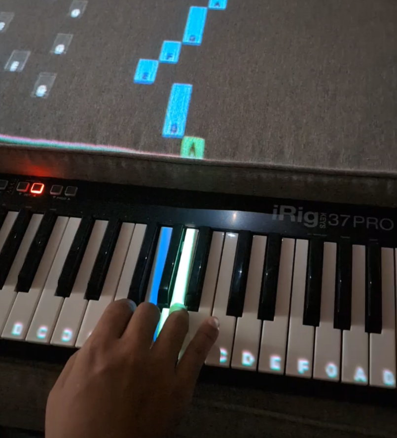

# Pianolume

**English** | [日本語](README.ja.md)

Pianolume is a piano practice app that projects falling notes onto your real keyboard.
Think "Synthesia + projection mapping": a projector shows bars falling toward the keys, lights each key at the moment you should press it, and follows what you actually play over MIDI.

<p align="center">
  <a href="docs/images/pianolume_play.mp4"></a>
  <br>
  <a href="docs/images/pianolume_play.mp4">▶ Watch the demo video (20 s)</a>
</p>

> **Status:** early development (v0.1). Windows only. Developed and tested with an IK Multimedia iRig Keys 37 Pro.

## Features

- **Falling notes** in Synthesia style: OpenGL rendering, bar and beat lines, optional note names on the notes and on the keys
- **Projection onto the real keyboard:** the fall area and the key area are separate surfaces, each warped to fit the real keyboard
- **Calibration:** drag the corners onto the keyboard, zoom in for fine adjustments, square an area with one click, and correct where the black keys appear (they sit higher than the white keys, so they shift when the projector is at an angle). Save calibrations as profiles
- **MIDI files:** load `.mid` files and assign each part to right hand, left hand, accompaniment or mute. Change the speed and seek
- **Practice modes:** Listen, Play Along, and Wait (the song waits until you press the right keys), plus A-B looping
- **Built-in synth:** FluidSynth with any `.sf2` / `.sf3` SoundFont, WASAPI shared or exclusive mode, and a limiter
- **Keyboard support:** choose from 25 to 88 keys and detect the lowest key automatically. The app follows your keyboard's octave buttons and switches sounds with program change messages
- **Different keyboard sizes:** the screen keyboard can be wider than your input keyboard. Notes outside your keyboard's range are greyed out and played automatically

## Screenshots

The main window shows the same falling notes as the projection.


In the calibration editor, you drag the corners onto the real keyboard.


## Requirements

- Windows 10 / 11
- A MIDI keyboard (USB MIDI)
- A projector (optional: the app also works on a monitor alone)
- A SoundFont (`.sf2` / `.sf3`) for sound, for example [GeneralUser GS](https://schristiancollins.com/generaluser.php). No SoundFont is bundled.

## Building

You need:

- Visual Studio 2022 with the "Desktop development with C++" workload
- CMake 3.24 or later

```powershell
cmake -S . -B build -G "Visual Studio 17 2022" -A x64
cmake --build build --config Release
```

CMake downloads JUCE and FluidSynth the first time you configure the build.
The executable is written to `build/Pianolume_artefacts/Release/Pianolume.exe`, next to the FluidSynth DLLs it needs.

Use the Release build for practice. The Debug build renders noticeably slower.

## Getting started

1. Connect your MIDI keyboard and start Pianolume.
2. Open **Settings**:
   - **Input keyboard:** choose your MIDI device and number of keys. Click **Detect** and press your leftmost key.
   - **Sound:** click **Load...** and choose a SoundFont.
3. Click **Open** (or drag and drop a file onto the window) to load a `.mid` file. Use **Parts** to choose which part each hand plays.
4. Press **Space** to play.

### Projector setup

1. Connect the projector as a second display and choose it under **Settings > Display > Projector**.
2. Click **Calibrate...** and drag the corners onto the real keyboard:
   - **1-2-3-4:** the fall area, the surface behind the keys
   - **4-3-5-6:** the key tops
   - If the two surfaces are at different heights, uncheck **Join fall area and keys** to adjust them separately.
3. Use **Black keys > Left end / Right end** if the black keys appear shifted.
4. Save the result with **Profiles > Save As...**.
5. Toggle the projection with the **Projection** button in the header.

## Controls

| Key | Action |
| --- | --- |
| Space | Play / pause |
| Home | Back to the start |
| ← / → | Seek 5 seconds |
| A / B | Set loop start / end |
| L | Toggle the loop |
| Esc | Close the full-screen projection |

### Calibration

| Input | Action |
| --- | --- |
| Drag a corner | Move it (hold Shift for fine moves) |
| Mouse wheel, `+` / `-` | Zoom |
| Drag the background (or right / middle drag) | Pan |
| `0`, double-click, **Whole Screen** | Show the whole projector screen |
| Arrow keys | Move the selected corner by 1 px (Shift: 10 px) |
| Tab | Select the next corner |

### Hardware notes

- **Octave buttons:** most keyboards don't send any MIDI message when you press them. After changing the octave, press the key at the end you moved toward once (the rightmost key after going up, the leftmost key after going down) so Pianolume can follow.
- **Program change:** program number *n* selects preset *n* in the current bank (falling back to bank 0).

## Third-party software

| Component | License |
| --- | --- |
| [JUCE](https://juce.com/) | AGPLv3 / commercial |
| [FluidSynth](https://www.fluidsynth.org/) | LGPL-2.1 (linked dynamically) |
| [libsndfile](https://libsndfile.github.io/libsndfile/) (bundled with the FluidSynth binaries) | LGPL-2.1 |
| [Inter](https://rsms.me/inter/) and [JetBrains Mono](https://www.jetbrains.com/lp/mono/) fonts | SIL Open Font License 1.1 (see `Resources/Fonts/`) |

## License

Pianolume is licensed under the [GNU Affero General Public License v3.0](LICENSE).
